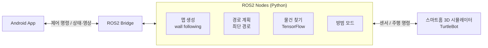

# 🤖 10JOBs — 스마트홈 IoT 로봇

**집안의 10가지 일을 대신하는 ROS2 기반 가정용 로봇과 제어 앱**

`SSAFY 5기 2학기 특화 프로젝트 (IoT 제어)` · `2021.08 ~ 2021.10 (7주)` · `5인 팀`

---

## 💡 프로젝트 소개

스마트홈 3D 시뮬레이터 위의 터틀봇(TurtleBot)을 ROS2로 제어해, 집 안을 스스로 돌아다니며 맵을 만들고 물건을 찾고 집을 지키는 **가정용 로봇**을 만들었습니다.
사용자는 **Android 앱**으로 로봇과 가전을 원격으로 제어하고, 로봇의 카메라 화면을 실시간으로 볼 수 있습니다.

---

## ✨ 주요 기능

| 기능 | 설명 |
|---|---|
| **맵 만들기** | 벽 따라가기(wall following) 자율주행으로 집 내부를 탐색하며 맵 생성 |
| **경로 이동** | 생성한 맵에서 최단 경로를 계산해 목적지까지 주행 |
| **물건 찾기** | TensorFlow로 학습시킨 객체 인식 모델로 카메라 영상에서 사용자가 찾는 물건 탐색 |
| **기기 제어** | 앱에서 집 안의 가전 기기(조명·에어컨 등) 원격 제어 |
| **실시간 보기** | 로봇 카메라 영상을 앱에서 실시간 확인 |
| **방범 모드** | 집을 비운 동안 로봇이 순찰하며 이상 상황 감지 |
| **배터리 표시** | 로봇 배터리 상태를 앱에 표시 |

---

## 🏗 시스템 구성

---

## 🛠 기술 스택

| 구분 | 기술 |
|---|---|
| **Robot** | ROS2, Python, launch 파일 기반 노드 일괄 실행 |
| **AI** | TensorFlow (객체 인식) |
| **App** | Android (Android Studio) |
| **Simulation** | 스마트홈 3D 시뮬레이터, TurtleBot |

---

## 👤 담당 역할 (장용원)

- 맵 생성과 경로 이동 등 로봇 주행 기능 개발
- 물건 찾기용 객체 인식 모델 학습과 ROS2 노드 연동
- Android 앱과 로봇 기능(기기 제어·실시간 보기·방범 모드) 연동
- 전체 노드를 하나의 launch 파일로 실행하는 환경 구성

---

## 🧩 트러블슈팅

**시뮬레이터 카메라 모드 제약 → 기본 카메라 영상으로 직접 학습**

- **문제** — 시뮬레이터의 Semantic 카메라 모드를 쓰면 물체를 쉽게 구분할 수 있지만, 외부 코드에서는 카메라 모드를 바꿀 수 없었습니다.
- **해결** — 기본 카메라 영상(None 모드)만으로 물건을 구분하도록 TensorFlow 객체 인식 모델을 직접 학습시켰습니다.
- **배운 점** — 환경이 주는 편의 기능에 기대기보다, 실제 운영 조건에서 동작하는 방법을 찾아야 한다는 것을 배웠습니다.

---

## 🚀 실행 방법

1. ROS2 설치 후 `catkin_ws`에서 빌드
2. `install/local_setup` 실행
3. `src/sub3/launch/final_launch.py` 실행 (브리지 포함 전체 노드 실행)
4. 시뮬레이터에서 맵 `V_IND_SmartHome1`, 차량 `TurtleBot`을 선택하고 Control Mode를 `AutoMode`로 설정
5. Android 앱 설치 후 실행

> 시뮬레이터와 교육 자료는 SSAFY 과정 내에서만 사용할 수 있어 이 저장소에 포함하지 않았습니다.
