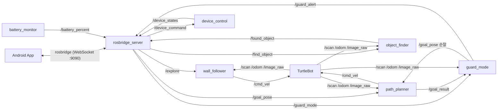

# 🔁 10JOBs — 2026 재구현 (Rebuild)

> 이 폴더는 2021년 SSAFY IoT 특화 프로젝트 **10JOBs**의 로봇 기능을 **2026년에 다시 구현한 ROS2 패키지**입니다.
> 원본 코드와 시뮬레이터는 SSAFY GitLab·교육 환경에만 있어 이 저장소에 포함되어 있지 않으며, 핵심 기능을 새로 작성했습니다.

> 📖 노드·토픽·알고리즘 상세 설명과 예상 면접 질문은 **[docs/CODE_GUIDE.md](docs/CODE_GUIDE.md)** 에 정리했습니다.

## 구성

```
rebuild/ten_jobs/                  # ROS2 ament_python 패키지
├── ten_jobs/
│   ├── algorithms/                # ROS 없이 테스트 가능한 순수 알고리즘
│   │   ├── wall_follow.py         # 오른쪽 벽 따라가기 (맵 생성용 탐색 주행)
│   │   ├── grid_path.py           # 점유 격자 A* 최단 경로 + 장애물 팽창 + 경유점 단순화
│   │   ├── motion_detect.py       # 프레임 차분 기반 움직임 감지 (방범 모드)
│   │   ├── patrol.py              # 순찰 지점 순환, 도달 실패 지점 건너뛰기
│   │   ├── devices.py             # 조명·에어컨·TV·커튼 상태 규칙
│   │   └── battery.py             # 배터리 평활화(EMA) + 저전력 히스테리시스
│   └── nodes/                     # ROS2 노드
│       ├── wall_follower.py       # /scan → /cmd_vel
│       ├── path_planner.py        # /map + /odom + /goal_pose → /global_path, /cmd_vel
│       ├── object_finder.py       # /image_raw + /find_object → /found_object (TensorFlow)
│       ├── guard_mode.py          # 순찰 + 정지 중 움직임 감지 → /guard_alert
│       ├── device_control.py      # /device_command → /device_states
│       └── battery_monitor.py     # /battery_state → /battery_percent, /battery_alert
├── launch/ten_jobs_launch.py      # 전체 노드 + rosbridge(앱 연동) 일괄 실행
└── test/                          # pytest 35개: 알고리즘 26 + 노드 9 (fake_ros.py로 ROS2 없이 실행)
```

## 기능과 토픽



| 기능 | 노드 | 설명 |
|---|---|---|
| 맵 만들기 | `wall_follower` | 오른쪽 벽과 일정 거리를 유지하며 집 내부 탐색 (P 제어, 전방 장애물 회피, 벽을 놓치면 우회전 탐색) |
| 경로 이동 | `path_planner` | 로봇 반경만큼 장애물을 팽창한 지도에서 A*로 경로 계산, 방향이 바뀌는 지점만 남겨 경유점 추종 |
| 물건 찾기 | `object_finder` | 일반 카메라 영상에 TensorFlow 객체 인식 모델을 적용해 요청한 물건 탐지 |
| 방범 모드 | `guard_mode` | 순찰 지점을 돌며, 멈춰 있을 때 이전 프레임과의 차이가 일정 비율을 넘으면 앱으로 알림 (쿨다운, 도달 실패 지점 건너뛰기) |
| 기기 제어 | `device_control` | 앱의 JSON 명령으로 조명·에어컨(18~30°C)·TV·커튼(0~100%) 제어, 잘못된 명령은 이유와 함께 거절 |
| 배터리 | `battery_monitor` | 전압·잔량을 평활화해 표시, 20% 미만이면 한 번만 알림, 정보가 없으면 0%가 아닌 '알 수 없음' |

## 실행

```bash
# ROS2 워크스페이스에 패키지 복사 후 빌드
cd ~/ros2_ws/src && cp -r <repo>/rebuild/ten_jobs .
cd ~/ros2_ws && colcon build --packages-select ten_jobs && source install/setup.bash

# 전체 실행 (물건 찾기 모델 경로 지정)
ros2 launch ten_jobs ten_jobs_launch.py model_dir:=/path/to/saved_model

# 알고리즘 + 노드 테스트 35개 (ROS 없이 실행 가능)
cd rebuild/ten_jobs && python -m pytest test
```
