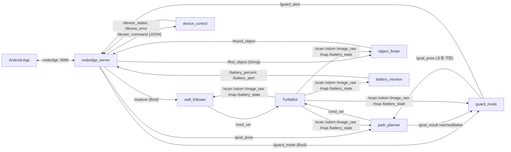
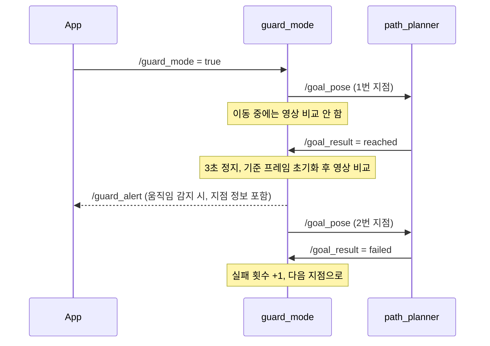

# 📖 10JOBs 재구현 — 코드 가이드

`rebuild/ten_jobs`는 스마트홈 로봇 기능을 담은 **ROS2(ament_python) 패키지**입니다.
이 문서는 각 노드가 무엇을 듣고(subscribe) 무엇을 말하는지(publish), 핵심 알고리즘이 어떻게 동작하는지,
그리고 ROS2 없이도 어떻게 테스트하는지를 정리합니다.

---

## 1. 설계 원칙: "알고리즘"과 "ROS 노드"를 분리

```
ten_jobs/
├── algorithms/   ← 순수 Python/NumPy. ROS를 전혀 import하지 않음 → pytest로 바로 테스트
└── nodes/        ← ROS2 노드. 메시지를 받아 algorithms 함수를 호출하고 결과를 publish만 함
```

- 로봇·시뮬레이터 없이도 경로 탐색, 벽 따라가기, 움직임 감지 같은 **판단 로직을 단위 테스트**할 수 있습니다.
- 노드는 얇게(thin) 유지해서, 버그가 생기면 대부분 `algorithms/`의 테스트로 재현할 수 있습니다.
- 노드 자체는 `test/fake_ros.py`의 가짜 rclpy로 메시지를 흘려 넣어 검증합니다(아래 5장).

## 2. 노드와 토픽 전체 그림



| 노드 | 입력 | 출력 | 하는 일 |
|---|---|---|---|
| `wall_follower` | `/scan`, `/explore` | `/cmd_vel` | 오른쪽 벽을 따라 집 내부를 돌며 맵 생성용 탐색 |
| `path_planner` | `/map`, `/odom`, `/goal_pose` | `/global_path`, `/cmd_vel`, `/goal_result` | A* 경로 계획 + 경유점 추종 주행 |
| `object_finder` | `/image_raw`, `/find_object` | `/found_object` | TensorFlow 모델로 요청한 물건 탐지 |
| `guard_mode` | `/image_raw`, `/guard_mode`, `/goal_result` | `/guard_alert`, `/goal_pose` | 순찰하며 멈춰 있을 때만 움직임 감지 |
| `device_control` | `/device_command` | `/device_states`, `/device_error` | 조명·에어컨·TV·커튼 상태 관리 |
| `battery_monitor` | `/battery_state` | `/battery_percent`, `/battery_alert` | 배터리 평활화 + 저전력 알림 |

## 3. 핵심 알고리즘

### 3-1. 벽 따라가기 (`algorithms/wall_follow.py`)
라이다 360개 값을 **전방(345°~15°), 오른쪽(255°~285°), 오른쪽 앞(300°~330°)** 세 구간으로 나눠 최솟값을 봅니다.

| 상황 | 동작 |
|---|---|
| 전방 장애물 < 0.5m | 제자리 좌회전 |
| 오른쪽 벽이 1.2m 밖으로 사라짐(문·모서리) | 오른쪽으로 크게 돌며 벽 다시 찾기 |
| 그 외 | 오른쪽 벽과 0.45m를 유지하도록 **P 제어** (`angular = kp × 거리 오차`) |

0이나 `inf` 같은 잘못된 라이다 값은 걸러서 계산합니다.

### 3-2. A* 경로 탐색 (`algorithms/grid_path.py`)
1. **장애물 팽창(inflate)**: 로봇 반경만큼 장애물을 키워서, 경로가 벽에 붙지 않게 합니다. 미탐색(-1) 칸도 막힌 칸으로 취급합니다.
2. **A\***: 8방향 이동, 대각선 비용 √2, 휴리스틱은 octile distance. 두 장애물 사이 대각선으로 빠져나가는 "모서리 자르기"를 막습니다.
3. **경로 단순화(simplify)**: 방향이 바뀌는 칸만 남겨 경유점 수를 줄입니다.

`path_planner` 노드는 다음 경유점을 향해 방향 오차가 크면 제자리 회전, 작으면 전진하는 방식으로 따라갑니다.

### 3-3. 움직임 감지 (`algorithms/motion_detect.py`)
- 프레임을 흑백으로 바꾼 뒤 이전 프레임과 픽셀별 차이를 구하고, **바뀐 픽셀 비율**이 기준(2%)을 넘으면 알림
- 한 번 알리면 30프레임 동안 쿨다운해 같은 사건으로 알림이 폭주하지 않게 함
- 로봇이 움직이는 동안은 화면 전체가 바뀌므로, `guard_mode`는 **순찰 지점에 멈춰 있을 때만** 비교합니다.

### 3-4. 순찰 (`algorithms/patrol.py`)
- 순찰 지점을 순서대로 반복 방문
- `path_planner`가 `failed`를 보낸 지점은 실패 횟수를 세고, 2번 실패하면 건너뜀
- 모든 지점이 실패하면 순찰을 멈추고 제자리 감시로 전환

### 3-5. 가전 제어 (`algorithms/devices.py`)
- 기기 종류별 규칙: 스위치(on/off/toggle), 온도 조절기(에어컨 18~30°C), 커튼(0~100%)
- 범위를 벗어난 값, 없는 기기, 없는 동작은 `DeviceError` → `/device_error`로 앱에 이유 전달
- `all_off`: 외출 시 모든 기기를 한 번에 끄기
- 상태 토픽은 **transient local QoS**로 발행해, 나중에 접속한 앱도 마지막 상태를 바로 받습니다.

### 3-6. 배터리 (`algorithms/battery.py`)
- 가속할 때 전압이 순간적으로 떨어지므로 **지수 이동 평균(EMA)**으로 평활화
- 저전력 알림은 **히스테리시스**: 20% 아래로 내려가면 한 번 알리고, 25%를 넘어야 해제 → 경계값 근처에서 알림이 반복되지 않음
- 시뮬레이터는 배터리 정보를 주지 않으므로, 데이터가 없으면 0%가 아니라 `-1`(알 수 없음)을 보냅니다.
  원본 프로젝트에서 "배터리 0%로 표시되는 문제"를 이렇게 해결했습니다.

## 4. 순찰 + 방범 모드 흐름



## 5. 테스트 (ROS2 없이 35개)

```bash
cd rebuild/ten_jobs && python -m pytest test
```

| 파일 | 대상 | 개수 |
|---|---|---|
| `test_grid_path.py` | A*, 장애물 팽창, 경로 단순화 | 6 |
| `test_wall_follow.py` | 벽 따라가기 판단 | 5 |
| `test_motion_detect.py` | 움직임 감지, 쿨다운 | 3 |
| `test_devices.py` | 가전 상태 규칙, 잘못된 명령 | 5 |
| `test_battery.py` | 전압 변환, 평활화, 히스테리시스 | 3 |
| `test_patrol.py` | 순찰 순서, 실패 지점 건너뛰기 | 4 |
| `test_nodes.py` | **노드 단위**: 메시지를 넣고 publish 결과 확인 | 9 |

`test_nodes.py`는 `test/fake_ros.py`가 rclpy·메시지 패키지를 흉내 내서 동작합니다.
publisher가 보낸 메시지를 기록하고, 구독 콜백·타이머를 테스트에서 직접 실행할 수 있게 만들었습니다.
예를 들어 "벽 가운데 틈이 있는 지도에서 목표를 주면 틈으로 돌아가는 경로를 만들고, 도착하면 `reached`를 보내는가"를 로봇 없이 확인합니다.
실제 ROS2가 설치된 환경에서는 가짜 모듈 대신 진짜 패키지가 쓰이고, 노드 테스트는 건너뜁니다.

## 6. 한계와 다음 단계

| 현재 | 개선 방향 |
|---|---|
| 직접 만든 A* + 단순 추종 | 실서비스라면 **Nav2**(costmap, DWB/MPPI 컨트롤러)로 동적 장애물 회피 |
| 맵 생성은 벽 따라가기 탐색 + 외부 SLAM | `slam_toolbox` 연동, frontier 기반 자율 탐색 |
| 프레임 차분 움직임 감지 | 조명 변화에 약함 → 배경 모델링(MOG2)이나 사람 검출 모델 |
| 가전 상태는 메모리에만 저장 | 실제 IoT 기기(MQTT, Matter) 연동과 상태 영속화 |
| 노드 테스트는 가짜 rclpy | `launch_testing`으로 실제 ROS2 통합 테스트 |

## 7. 예상 면접 질문

**Q. 왜 알고리즘과 노드를 나눴나요?**
로봇이나 시뮬레이터를 매번 띄우지 않고도 판단 로직을 빠르게 테스트하기 위해서입니다. 노드는 메시지 변환과 publish만 하도록 얇게 만들었습니다.

**Q. A\*에서 휴리스틱을 octile distance로 쓴 이유는?**
8방향 이동에서 대각선 비용이 √2일 때 실제 최단 거리를 넘지 않는(admissible) 가장 정확한 추정치라, 최적 경로를 보장하면서 탐색할 칸 수를 줄일 수 있습니다.

**Q. 장애물 팽창은 왜 필요한가요?**
격자 경로는 로봇을 점으로 보고 계산하기 때문에, 그대로 따라가면 몸체가 벽에 부딪힙니다. 로봇 반경만큼 장애물을 키워 두면 경로의 모든 칸이 안전 거리를 갖게 됩니다.

**Q. 방범 모드에서 오탐을 어떻게 줄였나요?**
움직이는 동안에는 비교하지 않고, 지점에 도착하면 기준 프레임을 새로 잡습니다. 또 바뀐 픽셀 비율 기준과 쿨다운을 둬서 작은 노이즈나 같은 사건의 반복 알림을 막았습니다.

**Q. 시뮬레이터 카메라 모드를 바꿀 수 없었던 문제는?**
Semantic 카메라를 쓰면 물체 구분이 쉽지만 외부 코드에서 모드를 바꿀 수 없었습니다. 그래서 일반 RGB 영상으로 TensorFlow 객체 인식 모델을 학습시켜 물건을 찾도록 바꿨습니다.

**Q. 앱은 ROS2와 어떻게 통신하나요?**
`rosbridge_server`가 ROS 토픽을 WebSocket(JSON)으로 열어 주고, 앱은 토픽을 구독하거나 발행하기만 하면 됩니다. 앱에 ROS 라이브러리를 넣을 필요가 없습니다.
